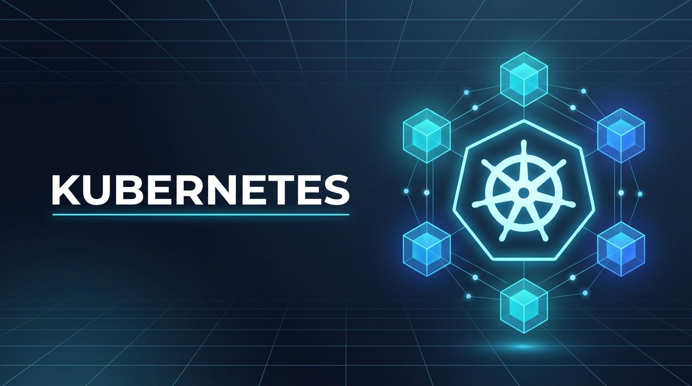

<div align="center">



# ☸️ Kubernetes

**Apuntes, prácticas paso a paso y tareas de orquestación de contenedores con Kubernetes, Minikube y `kubectl`.**


</div>

---

## 📚 Índice de unidades

| Unidad | Contenido | Estado |
| :---: | :--- | :---: |
| **UD1** | [1. Introducción](/UD1/1.md) | ✅ Completado |
| **UD2** | [2. Instalación](/UD2/2.md) *(Minikube, `kubectl` y autocompletado)* | ✅ Completado |
| **UD3** | [3. PODs](/UD3/3.md)<br>↳ [3.2. Tarea: Trabajando con Pods](/UD3/tarea3.2.md)<br>↳ [3.3. Tarea: Trabajando con un Pod multicontenedor](/UD3/tarea3.3.md) | ✅ Completado |
| **UD4** | [4. Replica sets](/UD4/4.md) | 🚧 En progreso |
| **UD5** | [5. Deployment](/UD5/5.md) | 📝 Pendiente |

---

## 📁 Estructura del repositorio

```text
Kubernetes/
├── README.md
├── img/            # Capturas de pantalla y recursos gráficos
├── UD1/            # 1.md (Introducción)
├── UD2/            # 2.md (Instalación) + contenido/ (PDFs y ODTs)
├── UD3/            # 3.md, tarea3.2.md, tarea3.3.md + contenido/ (PDFs y YAMLs)
├── UD4/            # 4.md (Replica sets) + contenido/ (PDF y YAML)
└── UD5/            # 5.md (Deployment)
```

---

## 🛠️ Entorno utilizado

- **Sistema operativo:** Ubuntu Linux
- **Clúster local:** Minikube (`containerd` / Docker / VirtualBox)
- **CLI:** `kubectl` con autocompletado en Bash
