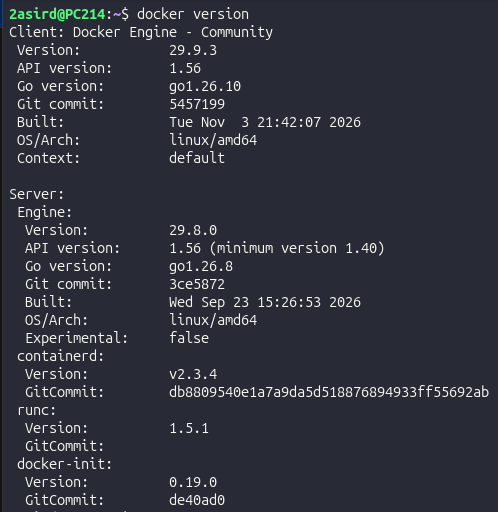
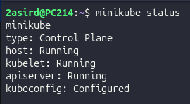
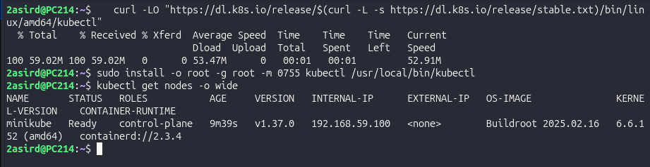

# INSTALACIÓN

En esta unidad se documenta la instalación y puesta en marcha de un clúster local de Kubernetes mediante **Minikube** junto con la herramienta de línea de comandos **`kubectl`** en Ubuntu.

---

## 1. Comprobación previa de Docker

Antes de instalar Minikube, verificamos que **Docker** esté instalado y funcionando correctamente en el equipo:

```bash
docker version
```



---

## 2. Descarga e instalación de Minikube

Descargamos el binario oficial de **Minikube** para Linux (`amd64`), lo instalamos en `/usr/local/bin/minikube` y eliminamos el archivo descargado:

```bash
curl -LO https://github.com/kubernetes/minikube/releases/latest/download/minikube-linux-amd64
sudo install minikube-linux-amd64 /usr/local/bin/minikube && rm minikube-linux-amd64
```


Comprobamos que la instalación se haya realizado correctamente consultando la versión instalada:

```bash
minikube version
```


---

## 3. Arranque del clúster local

Iniciamos el clúster de Kubernetes ejecutando:

```bash
minikube start
```

> [!NOTE]
> Al intentar arrancar con el controlador `docker`, se produjo un error de aprovisionamiento y Minikube cambió automáticamente al controlador alternativo **`virtualbox`**, creando la máquina virtual del nodo *control-plane* con Kubernetes `v1.37.0` sobre `containerd`.


---

## 4. Verificación del estado y perfiles del clúster

Comprobamos que todos los componentes del clúster (`host`, `kubelet`, `apiserver` y `kubeconfig`) estén activos:

```bash
minikube status
```



También podemos listar los perfiles configurados para ver el controlador, el *runtime*, la IP asignada (`192.168.59.100`) y la versión de Kubernetes:

```bash
minikube profile list
```


---

## 5. Instalación y prueba de `kubectl`

Descargamos la última versión estable de **`kubectl`**, le asignamos los permisos adecuados y verificamos la conexión con el nodo del clúster:

```bash
curl -LO "https://dl.k8s.io/release/$(curl -L -s https://dl.k8s.io/release/stable.txt)/bin/linux/amd64/kubectl"
sudo install -o root -g root -m 0755 kubectl /usr/local/bin/kubectl
kubectl get nodes -o wide
```



---

## 6. Activación del autocompletado de comandos

Para facilitar el trabajo diario en la terminal, activamos el autocompletado en Bash tanto para `kubectl` como para `minikube` y recargamos `~/.bashrc`:

```bash
echo 'source <(kubectl completion bash)' >> ~/.bashrc
echo 'source <(minikube completion bash)' >> ~/.bashrc
source ~/.bashrc
```


