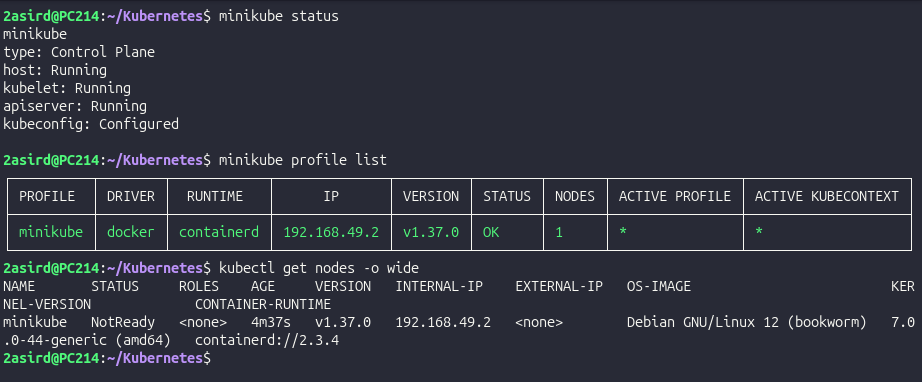
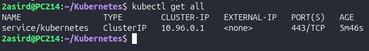
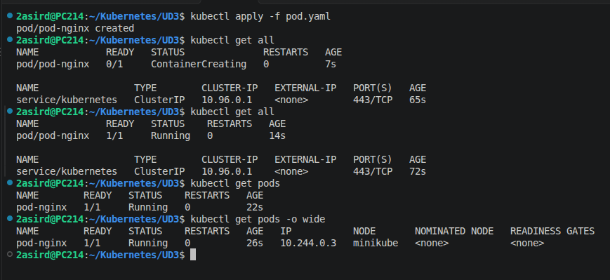
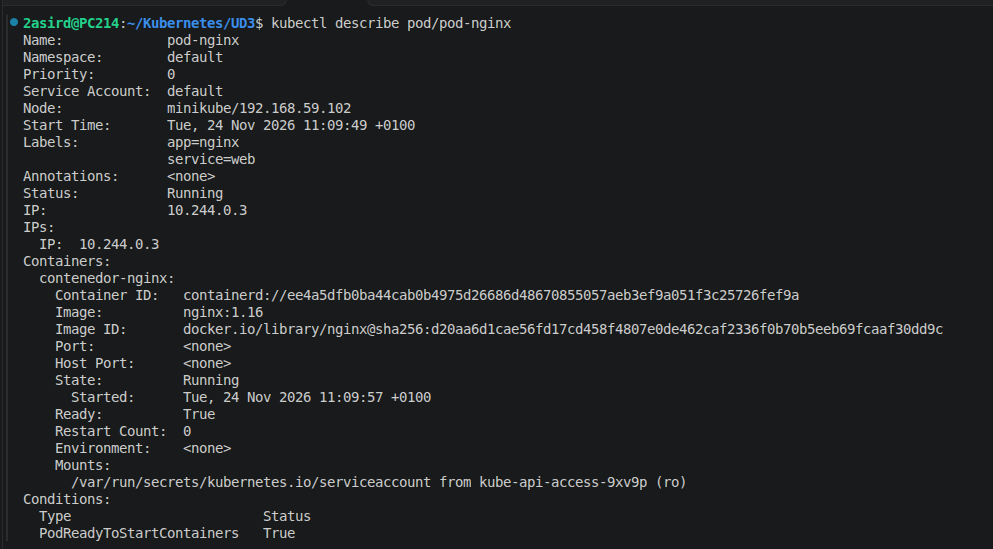
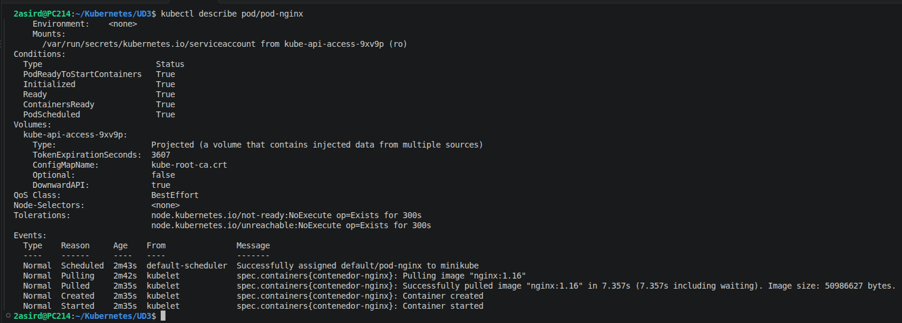
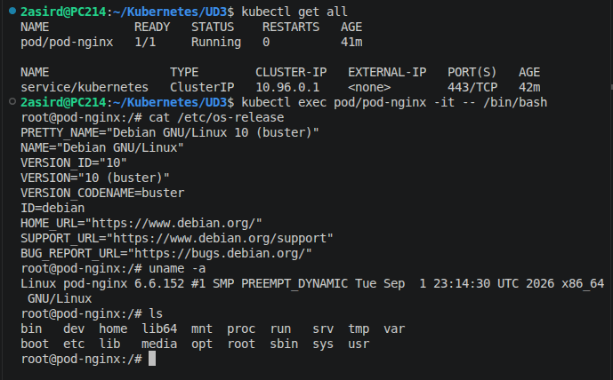
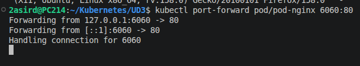
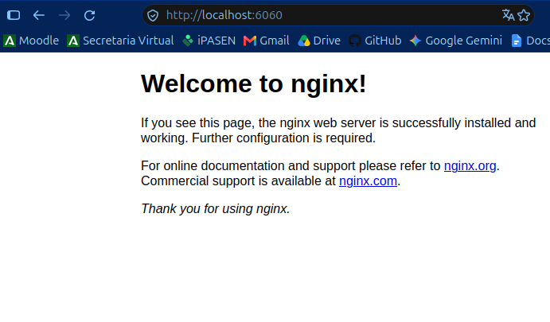
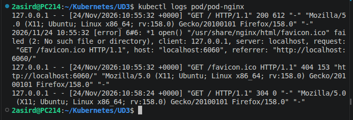

# PODs

## ¿Qué es un Pod?

Un **Pod** es la unidad mínima de despliegue y ejecución en Kubernetes. Encapsula uno o varios contenedores (normalmente uno solo) que comparten la misma dirección IP, el mismo espacio de red y, si se configuran, volúmenes de almacenamiento comunes.

Los Pods son **efímeros**: tienen un ciclo de vida limitado y, si fallan o se eliminan, Kubernetes no los repara, sino que crea Pods nuevos en su lugar.

---

## 1. Comprobación previa del clúster

Antes de empezar a desplegar Pods, verificamos que Minikube esté activo, comprobamos el perfil configurado y consultamos el estado del nodo con `kubectl`:

```bash
minikube status
minikube profile list
kubectl get nodes -o wide
```



---

## 2. Consulta de recursos iniciales

Ejecutamos `kubectl get all` para listar los recursos existentes en el *namespace* `default`. Al estar recién iniciado el entorno, únicamente aparece el servicio interno `service/kubernetes` y todavía no hay ningún Pod desplegado:

```bash
kubectl get all
```



---

## 3. Creación y verificación de un Pod con manifiesto YAML

Desplegamos el Pod `pod-nginx` a partir del fichero [pod.yaml](/UD3/contenido/pod.yaml) (que ejecuta un contenedor con la imagen `nginx:1.16`) y comprobamos cómo pasa del estado `ContainerCreating` a `Running`, además de ver su IP interna (`10.244.0.3`) y el nodo asignado (`minikube`) con `-o wide`:

```bash
kubectl apply -f pod.yaml
kubectl get all
kubectl get pods
kubectl get pods -o wide
```



---

## 4. Inspección detallada del Pod

Con `kubectl describe` podemos consultar información detallada del Pod `pod-nginx`: etiquetas (`app=nginx`, `service=web`), IP asignada, estado del contenedor `contenedor-nginx`, condiciones, volúmenes y el historial de eventos (*Scheduled*, *Pulling*, *Pulled*, *Created*, *Started*), muy útil para diagnosticar incidencias:

```bash
kubectl describe pod/pod-nginx
```





---

## 5. Acceso interactivo al contenedor (`kubectl exec`)

Podemos abrir una sesión interactiva de consola dentro del contenedor del Pod con `kubectl exec -it` para inspeccionar su entorno (por ejemplo, comprobar la distribución con `cat /etc/os-release`, el kernel con `uname -a` o listar directorios con `ls`):

```bash
kubectl exec pod/pod-nginx -it -- /bin/bash
```



---

## 6. Redirección de puertos (`kubectl port-forward`) y acceso web

Para probar el servidor web Nginx desde nuestro equipo local sin crear todavía un Service externo, redirigimos el puerto local `6060` al puerto `80` del Pod:

```bash
kubectl port-forward pod/pod-nginx 6060:80
```



Al acceder desde el navegador a `http://localhost:6060`, comprobamos que Nginx responde correctamente con su página de bienvenida:



---

## 7. Consulta de registros (`kubectl logs`)

Con `kubectl logs` consultamos la salida estándar y de errores del contenedor del Pod, donde quedan registradas las peticiones HTTP realizadas desde el navegador a `http://localhost:6060`:

```bash
kubectl logs pod/pod-nginx
```


