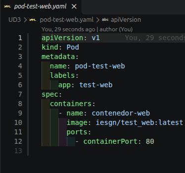
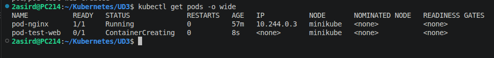
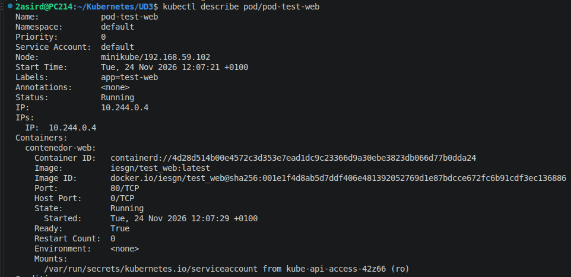
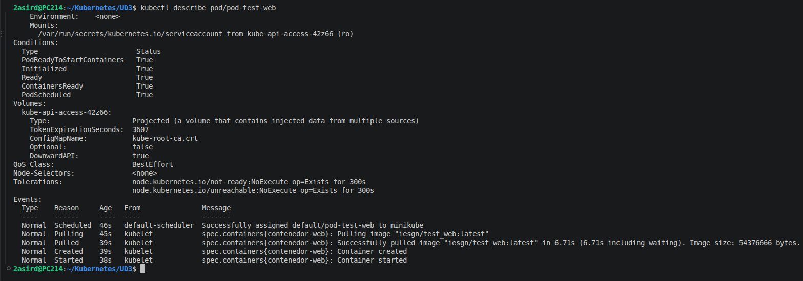
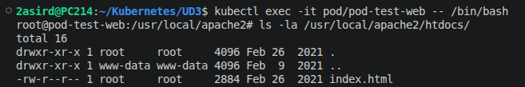
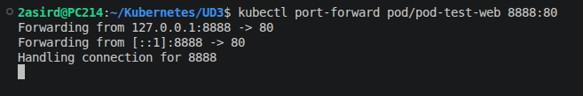
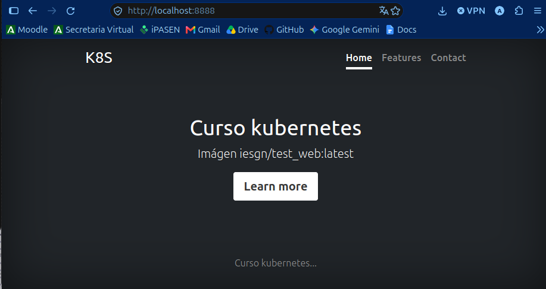
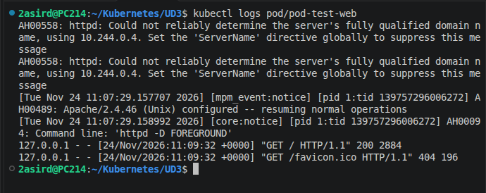

# 3.2. TRABAJANDO CON PODS

En esta tarea se despliega un Pod con la imagen `iesgn/test_web:latest` (servidor web Apache con una página estática) y se realizan operaciones básicas de inspección, acceso interactivo, redirección de puertos, consulta de registros y eliminación.

---

## 1. Creación del fichero YAML del Pod

Creamos el manifiesto [pod-test-web.yaml](/UD3/contenido/pod-test-web.yaml) definiendo:

- **Nombre del Pod:** `pod-test-web`
- **Nombre del contenedor:** `contenedor-web` (distinto al del Pod)
- **Imagen:** `iesgn/test_web:latest`
- **Etiqueta:** `app: test-web`

```yaml
apiVersion: v1
kind: Pod
metadata:
  name: pod-test-web
  labels:
    app: test-web
spec:
  containers:
    - name: contenedor-web
      image: iesgn/test_web:latest
      ports:
        - containerPort: 80
```



---

## 2. Creación del Pod

Desplegamos el Pod en el clúster a partir del fichero YAML:

```bash
kubectl apply -f pod-test-web.yaml
```

---

## 3. Comprobación de que el Pod está creado y en ejecución

Verificamos el estado del Pod y el nodo donde se ha desplegado con `kubectl get pods -o wide`:

```bash
kubectl get pods -o wide
```



---

## 4. Información detallada del Pod

Obtenemos la descripción completa del Pod (`pod-test-web` en estado `Running`, IP `10.244.0.4`, etiqueta `app=test-web`, contenedor `contenedor-web` en el puerto `80/TCP`, condiciones, volúmenes y eventos):

```bash
kubectl describe pod/pod-test-web
```





---

## 5. Acceso interactivo y comprobación del DocumentRoot

Accedemos de forma interactiva al contenedor del Pod y comprobamos la existencia del fichero `index.html` dentro de `/usr/local/apache2/htdocs/`:

```bash
kubectl exec -it pod/pod-test-web -- /bin/bash
ls -la /usr/local/apache2/htdocs/
```



---

## 6. Redirección de puertos (`kubectl port-forward`) y acceso web

Redirigimos el puerto local `8888` al puerto `80` del Pod:

```bash
kubectl port-forward pod/pod-test-web 8888:80
```



Al acceder desde el navegador a `http://localhost:8888`, se muestra correctamente la web servida por la imagen `iesgn/test_web:latest`:



---

## 7. Consulta de los logs del Pod

Mostramos los registros del Pod y verificamos que aparecen el arranque de Apache y las peticiones HTTP (`GET / HTTP/1.1` con código `200`) del acceso realizado desde el navegador:

```bash
kubectl logs pod/pod-test-web
```



---

## 8. Eliminación del Pod y comprobación

Eliminamos el Pod y verificamos que ya no aparece en el clúster:

```bash
kubectl delete -f pod-test-web.yaml
kubectl get pods
```
