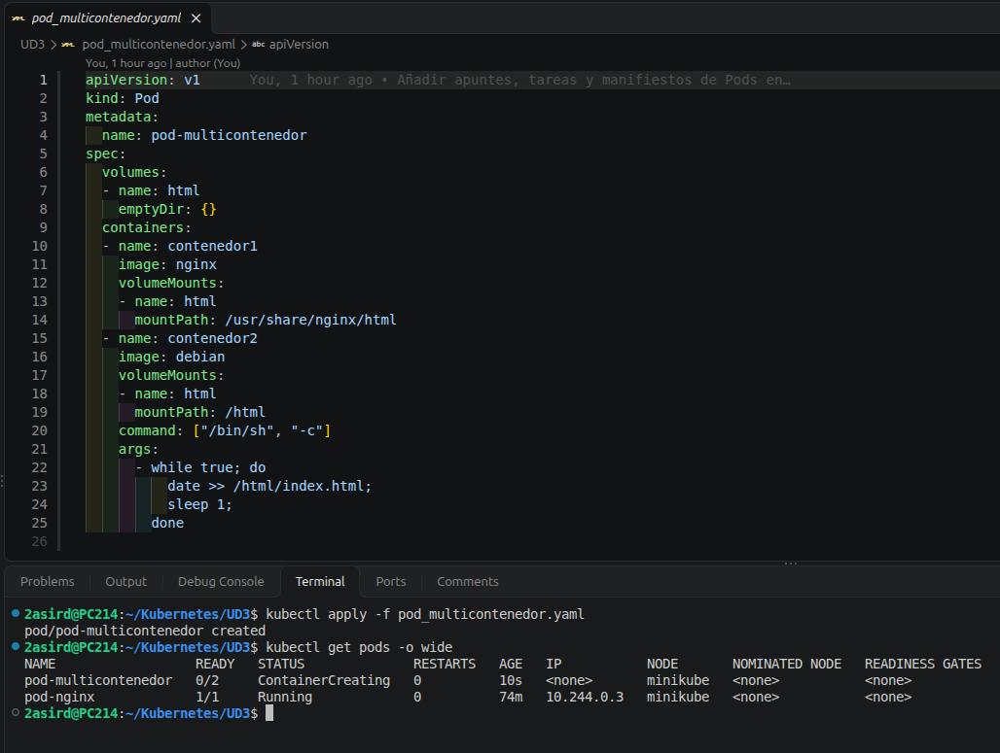
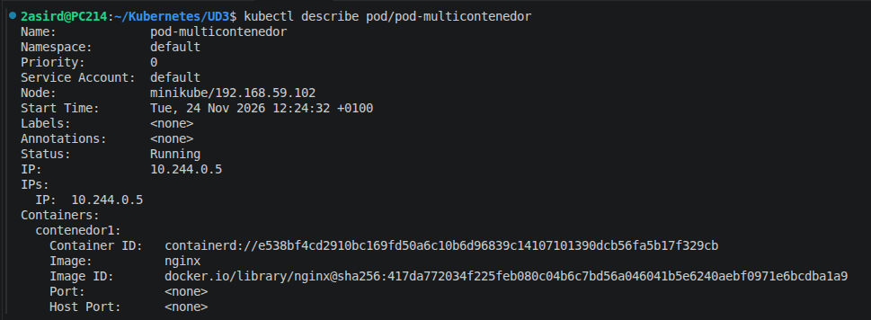
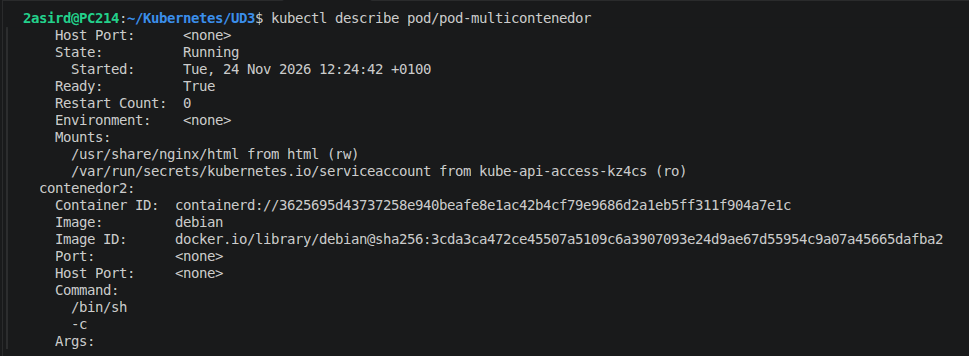
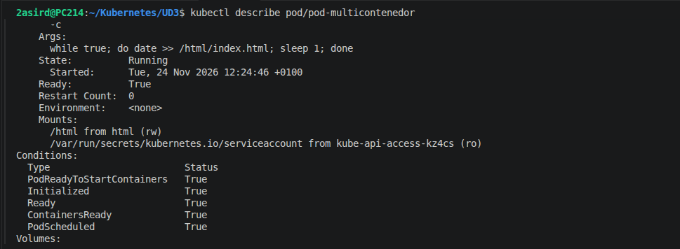
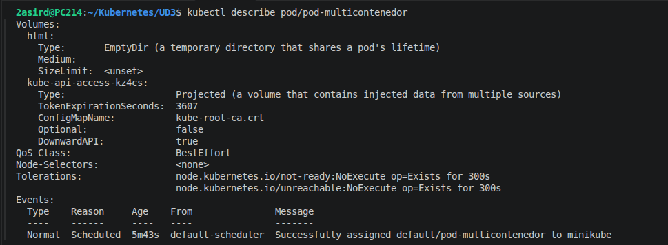
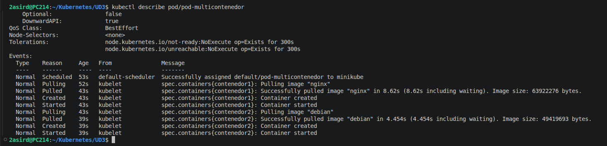
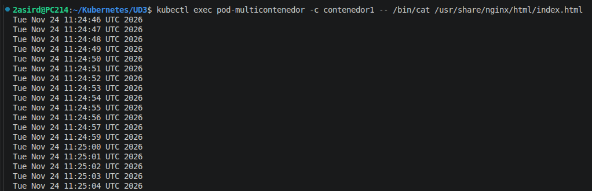
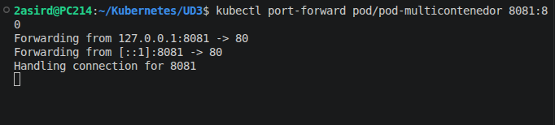
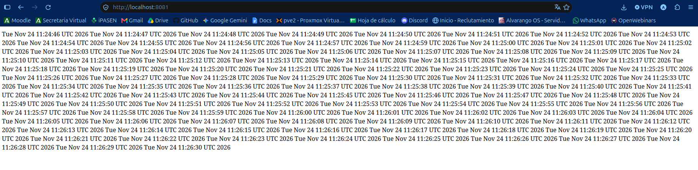

# 3.3. TRABAJANDO CON UN POD MULTICONTENEDOR

Un **Pod multicontenedor** permite ejecutar varios contenedores estrechamente acoplados (una aplicación principal y uno o más contenedores auxiliares o *sidecars*) que comparten red (`localhost`) y almacenamiento mediante **volúmenes**.

En esta tarea desplegamos el manifiesto [pod_multicontenedor.yaml](/UD3/contenido/pod_multicontenedor.yaml), que define el Pod `pod-multicontenedor` con:

- **Volumen `html` (`emptyDir`):** directorio compartido entre los dos contenedores (efímero: se pierde al eliminar el Pod).
- **`contenedor1` (`nginx`):** contenedor principal que monta el volumen `html` en `/usr/share/nginx/html` para servir la página web.
- **`contenedor2` (`debian`):** contenedor auxiliar que monta el mismo volumen en `/html` y añade la fecha y hora actual a `/html/index.html` cada segundo.

---

## 1. Definición del Pod multicontenedor

Revisamos el fichero [pod_multicontenedor.yaml](/UD3/contenido/pod_multicontenedor.yaml):

```yaml
apiVersion: v1
kind: Pod
metadata:
  name: pod-multicontenedor
spec:
  volumes:
  - name: html
    emptyDir: {}
  containers:
  - name: contenedor1
    image: nginx
    volumeMounts:
    - name: html
      mountPath: /usr/share/nginx/html
  - name: contenedor2
    image: debian
    volumeMounts:
    - name: html
      mountPath: /html
    command: ["/bin/sh", "-c"]
    args:
      - while true; do
          date >> /html/index.html;
          sleep 1;
        done
```

---

## 2. Creación del Pod

Desplegamos el Pod multicontenedor en el clúster y comprobamos que aparece con `0/2` contenedores mientras se crean ambas imágenes:

```bash
kubectl apply -f pod_multicontenedor.yaml
kubectl get pods -o wide
```



---

## 3. Información del Pod (volumen y dos contenedores)

Inspeccionamos el Pod con `kubectl describe` para comprobar sus datos generales (`Status: Running`, IP `10.244.0.5`), los dos contenedores (`contenedor1` con `nginx` y `contenedor2` con `debian`), sus puntos de montaje sobre el volumen compartido `html` (`EmptyDir`), las condiciones y los eventos de arranque:

```bash
kubectl describe pod/pod-multicontenedor
```











---

## 4. Comprobación de `index.html` en `contenedor1`

Cuando un Pod tiene más de un contenedor, es necesario indicar el parámetro `-c` para elegir en cuál ejecutar el comando. Consultamos `index.html` desde el contenedor de Nginx (`contenedor1`):

```bash
kubectl exec pod-multicontenedor -c contenedor1 -- /bin/cat /usr/share/nginx/html/index.html
```



---

## 5. Comprobación de `index.html` en `contenedor2`

Consultamos el mismo fichero desde el punto de montaje `/html` en el contenedor auxiliar (`contenedor2`) y verificamos que ambos comparten el volumen `html` y ven las mismas fechas actualizándose cada segundo:

```bash
kubectl exec pod-multicontenedor -c contenedor2 -- /bin/cat /html/index.html
```


---

## 6. Redirección de puertos (`8081:80`) y acceso desde el navegador

Creamos un `port-forward` del puerto local `8081` al puerto `80` del Pod:

```bash
kubectl port-forward pod/pod-multicontenedor 8081:80
```



Al acceder desde el navegador a `http://localhost:8081`, comprobamos que Nginx sirve el fichero `index.html` con las fechas que va añadiendo `contenedor2` cada segundo:


